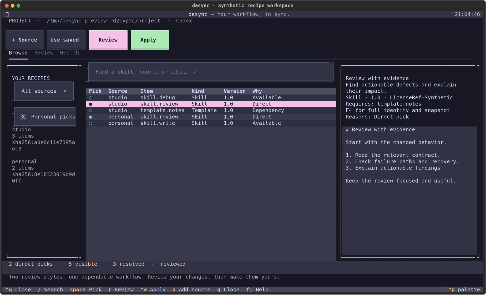
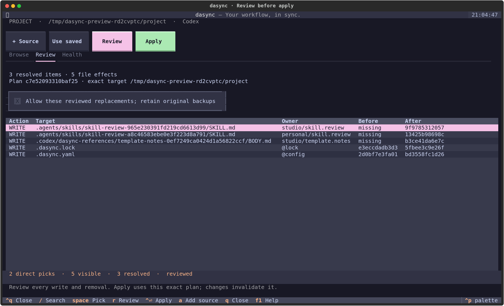

# Experimental local recipe protocol

This implements the local engine spine of the [recipe plan](plans/2026-10-06-dasync-recipe-spine-plan.html), through the existing Engine and SQLite transaction journal, with a human workspace and a [reproducible transition of all 70 collected items](../recipes/README.md). It supports local recipes and singleton items, explicit cross-recipe dependencies, personal/project composition, and Codex Skills, native agents, unconditional policies, Markdown/HTML Templates, public Contexts and separately approved Python Hooks. Later launch milestones remain unimplemented. Legacy catalog commands remain available for existing scopes; there is no automatic migration or adoption of existing configuration, grants or provider files.

## Discovery and contracts

`dasync --version` reports the installed distribution version. `dasync describe --json --no-input` works without configuration and advertises protocol 1, operation input/output schemas, effects, approvals, formats, limits and unsupported features. Unknown `--protocol` versions fail before environment access. `dasync schema NAME` exports offline JSON Schema 2020-12 for `recipe`, `item-spec`, `local-item`, `recipe-slot`, `recipe-intent`, `recipe-lock`, `recipe-request`, `recipe-plan` and `recipe-error`. Runtime validation uses these same bundled contracts and never resolves publisher-supplied schema URLs.

Recipe/ItemSpec format 1, machine protocol 1, intent/plan version 2, recipe state metadata/receipt version 1, adapter `recipe-codex/2` and mapping version 1 are independent versions. The adapter generation changed for the collection transition; old reviewed plans need replanning, and managed receipt reactivation across adapter generations requires a separate reviewed migration. `requires_engine` uses the actual installed version and PEP 440 constraints. Understood feature gates are imports, native-agents, native-policies, python-hooks and context-contracts; unknown core fields/features, duplicate YAML keys, aliases, unsafe tags, invalid versions and unsafe paths fail closed. Namespaced scalar extensions are bounded annotations without behavioral authority.

## Canonical authoring

A recipe root contains `recipe.yaml`; `items` lists its ItemSpec manifests. Each ItemSpec declares the complete content closure relative to its manifest. A singleton instead has `item.yaml` containing `format`, a stable `source_id` and one `item` using exactly the same ItemSpec schema. Instruction entrypoints are Markdown without native frontmatter; Templates may have HTML entrypoints and Hooks have a declared Python entrypoint. Authors supply actual license information and notices; the engine does not infer rights or project facts.

Example `recipe.yaml`:

```yaml
format: 1
source_id: 11111111-1111-4111-8111-111111111111
name: synthetic-review
description: A synthetic recipe for disposable examples.
requires_engine: '>=0.1.1,<1'
required_features: []
items: [items/review/item.yaml]
imports: {}
```

Example `items/review/item.yaml`:

```yaml
format: 1
kind: Skill
id: skill.review
version: '1.0'
name: Review
description: Review a bounded change using source evidence.
license: LicenseRef-Synthetic
entry: SKILL.md
files: [SKILL.md]
scopes: [user, project]
requires: {}
required_capabilities: [filesystem.read]
optional_capabilities: []
default_prompt: Review this change and explain actionable findings.
```

`LicenseRef-Synthetic` labels examples only. Preparation reads only declared metadata/content and checks source entry types. It rejects symlinks, special files, execute bits, undeclared code and shell/native executables. Declared Python Hook files are retained as data without executing or approving them; Python files belonging to other kinds are rejected. It skips Git internals without reading commit objects, modifying the checkout, running scripts or contacting a service. Changing identity, metadata or declared content changes the tree pin; undeclared documentation is not part of that pin.

To scaffold one item, save a `recipe.create` request with a new `source_id`, `kind: Skill` or `Context`, `id`, `name`, `description` and explicit `license`. Run `dasync recipe create --request REQUEST.json --scope project --path ABSOLUTE_AUTHOR_DIRECTORY --dry-run --json --no-input`, review the plan and apply it normally. The existing disposable author directory must be unused by dasync. Engine apply writes `item.yaml` and `SKILL.md` or `CONTEXT.md` with a receipt. Context scaffolds contain a public explicit-access contract and authoring placeholders, never invented facts. Forks need a new source UUID; copying a UUID does not transfer origin trust.

## Prepare, review and apply

Set `DASYNC_HOME` to a disposable directory for experiments. Runtime mutations require explicit `--scope`; project scope also requires an existing absolute `--path`. Use operator-chosen absolute paths, never locators guessed from recipe prose.

```sh
dasync describe --json --no-input
dasync recipe prepare --source /absolute/source-a --json --no-input
dasync recipe prepare --source /absolute/source-b --json --no-input
```

Preparation returns a candidate token, UUID, `sha256:` tree pin and current item IDs. It creates only accounted immutable cache records; it does not register, trust or select anything. Save a request using the returned tokens:

```json
{
  "operation": "recipe.configure",
  "registrations": [
    {"candidate": "COPY_SOURCE_A_CANDIDATE_TOKEN", "alias": "alpha"},
    {"candidate": "COPY_SOURCE_B_CANDIDATE_TOKEN", "alias": "beta"}
  ],
  "enable": ["alpha/skill.review", "beta/skill.review"]
}
```

```sh
dasync recipe plan --request /absolute/request.json --trust-source \
  --scope project --path /absolute/project --json --no-input > /absolute/reviewed-plan.json
dasync recipe apply --plan /absolute/reviewed-plan.json \
  --scope project --path /absolute/project --yes --json --no-input
dasync recipe doctor --scope project --path /absolute/project --json --no-input
```

`--trust-source` is a distinct registration decision; `--yes` never supplies it. Registration binds the UUID, approved local root, accepted pins, alias and generation in private machine state. Another root claiming a registered UUID gets `ORIGIN_CONFLICT`, even with trust. Relocation and authority renewal need later protocol work. Candidate tokens and plan hashes are reviewed-input identifiers, not signatures or authenticated human approval.

Registration, intent/lock changes and provider writes commit through Engine apply under the same State lock and file journal. Registration metadata commits atomically with the successful receipt; interrupted file writes do not grant trust. Apply accepts a raw version 2 plan or its JSON success envelope and returns the actual changed flag, receipt and operation count. Scope, platform, versions, intent/lock observations, all pins, registry/authority generations, target observations and previous receipt bind the plan, which is rebuilt and compared under the lock before committing.

Unmanaged provider files, even byte-identical ones, and modified/missing managed files are protected. `conflict: overwrite` in a reviewed configure request preserves observed originals in receipt backups. Intent and lock edits are protected too. A different machine can inspect and resolve copied intent after supplying registrations; materialized files remain unmanaged there and require review. The two-home tests prove pure lock ownership, not complete team onboarding.

## Identity, roots and ownership

The authoritative key is `(source_id, item_id)`. Bare selectors fail with candidates when ambiguous; `alias/item` and `UUID/item` are explicit. Unique local aliases are labels, not identity or precedence. Native names combine a bounded item-ID component and a fixed 96-bit digest of the key. Alias/name changes and registration order do not change them. Exact/casefolded/directory-spelling/file-directory/reserved-name/length collisions fail without ordinal suffixes or a last-writer winner.

Configure requests use `enable`, `remove`, `disable`, `undisable`, `select_sources`, optional `bind_sources` and `inherit_user`. Removing a direct root preserves dependency reasons; disabling a required edge blocks resolution. `undisable` clears a tombstone without adding a direct root. A removed item can still be deselected by its qualified existing root during a snapshot update. `bind_sources: [{source_id: UUID, pin: "sha256:…"}]` chooses an exact already accepted pin without granting trust; competing bindings or a registration/binding mismatch fail. Bulk source selection expands only the current snapshot's IDs into roots. Accepting a new prepared snapshot does not select its new items. Missing items, cycles, disabled edges and incompatible PEP 440 constraints report qualified causes. There are no profiles, groups, implicit overrides or all-future selection flags. Within one configure request, selection expands first, followed by enable, remove, disable and undisable; JSON property/list ordering does not supply precedence.

Personal/project selections compose by default with one pin per UUID. Conflicting pins fail; explicitly disable inheritance for an independent project pin. Inherited hooks and non-inheritable contexts are excluded. Legacy personal catalogs cannot be inherited into recipe scopes; disable inheritance until a separate migration is designed. Resolver inheritance and native global visibility are distinct: disabling composition does not hide global provider files or prove Codex host precedence.

Project `.dasync.yaml` owns its pins, roots, disabled keys, provider and inheritance flag. `.dasync.lock` resolves only project-owned roots/dependencies and is identical under different personal additions. It stores UUIDs, pins, item versions/digests and edges with `portable: false`: local sources need separate bindings on each machine. It excludes local origins, personal-only graph, aliases, grants and native names. Private SQLite metadata owns registration/authority; receipts retain the effective graph, names, decisions, contributors, hashes, output bytes and original backups. Copied project names/UUIDs are not grants.

## References and capability boundaries

The finite Markdown grammar translates single-line inline link and reference-definition destinations `dasync:dependency/LOCAL_ID` or `dasync:dependency/IMPORT/ITEM_ID`, optionally followed by `/DECLARED_FILE` and `#fragment`. Targets must be selected dependencies declared in `requires`. `imports: {shared: {source_id: UUID}}` binds an author-facing key to a declared UUID; `requires: {shared/template.review: ">=1,<2"}` uses the environment's explicit accepted pin. Missing bindings return SOURCE_UNBOUND without registration, fetching, cache discovery or same-name substitution. Unused imports do not need binding. Import keys cannot shadow local item IDs. Rendering resolves nested relative paths through qualified native mappings. Invocations may use local or imported dependencies and emit the exact Skill invocation; default prompts receive the correct self `$native-name` from the adapter. Skills, agents and policies include a scoped index of selected dependency references.

Prose, fenced/indented examples, inline code, HTML comments and escaped link openings are literal. This is not a general CommonMark parser, template evaluator or web dereferencer; multiline/nested links are unsupported. Each artifact names its owner and contributors. Publisher metadata is serialized and never interpreted as a shell command. A separately approved Hook command is constructed from the retained Python runtime and installed script path. Structural validation does not certify model behavior or prompt safety.

Slot records validate required/optional status, cardinality one, UUID, PEP 440 constraint and Markdown format. Required slots and actual slot references fail until explicit bindings exist; absent optional slots are reported. Private/never context closure fails before output or lock emission. Explicit public contexts require a current-scope direct root. Format-level filesystem.read/write declarations are accepted; other essential capabilities fail. Optional capabilities and actual runtime availability remain unverified. Private context binding/read remains outside this implementation.

Agent records declare `agent: {access: inherit}`. The adapter emits native TOML name, description and developer_instructions; role permissions inherit the parent session. Current [Codex documentation](https://developers.openai.com/codex/subagents) says standalone agent sandbox overrides do not override parent configuration. Essential `access: read-only` is therefore refused. The legacy renderer also omits that ignored field. Both adapters serialize Unicode and control/quote characters without allowing metadata to inject configuration.

Policies declare `policy: {globs: [], priority: 0}`. Only unconditional policies are supported. Their bodies are retained as references and combined into project AGENTS.md or user .codex/AGENTS.md with qualified contributor provenance and rebased links. Existing files remain protected and original bytes remain recoverable under explicit overwrite. This does not establish host precedence or combined context-size behavior.

Hooks declare `executable: {runtime: python, events: [pre_tool], permissions: [stdin.read], timeout: 5}`. Supported events are pre_tool/session_start/stop. They need a direct root and a separate `approve_executables: [{source_id: UUID, item_id: ID, digest: EXACT_ITEM_DIGEST}]` decision. A refusal returns the qualified digest and executable-digest approval category. Approval commits atomically with successful registration/output/receipt into scope-local machine state; it is absent from intent/lock and never inherited. Changes to any approved item metadata or declared bytes require another exact approval. Sync retains the recorded interpreter independently of the CLI launcher. [Codex hook configuration](https://developers.openai.com/codex/hooks) combines events into scoped hooks.json with contributor provenance. Python Hooks require POSIX and run in the provider execution environment; declared permissions do not establish OS isolation. Lost current approval blocks managed receipt and journal reactivation with evidence retained.

## Retention, restore and urgent deny

Sync reads retained accepted snapshots and never advances pins or silently substitutes checkout edits. Limits are 4 MiB per file, 2,048 files/128 MiB per snapshot, 5,000 files/128 MiB across effective sources, 512 graph items/depth 64, 128 MiB rendered output and 4 MiB saved plans. Cache preparation uses a lock and a 4,096-record/512 MiB quota; failures never silently purge selected/history bytes. Garbage collection and state migrations are not shipped.

`recipe.sync --dry-run` previews synchronization; repeated identical sync returns no changes. `recipe.list` paginates at 50 items by default, up to 200; `recipe.explain SELECTOR` reports reasons and reverse dependents. No-input/machine commands emit one JSON envelope on stdout. Error contracts identify engine origin, effects/recovery inspection and required approvals without echoing raw private parser values. Source metadata is data, not remediation authority.

Plan `{"operation":"recipe.restore","receipt":"ID"}` to restore a successful receipt, optionally with `"before_receipt":true` for its original backups. Receipt bytes work offline even without source checkouts or snapshot cache. Managed reactivation checks current registrations, pins, personal configuration, adapter/mapping versions and deny ledger; old bytes do not renew authority. Unmanaged originals can be restored after denial. If cache was manually removed, subsequent doctor reports `SNAPSHOT_MISSING`; prepare exact source bytes before normal rendering again.

`recipe.recover --dry-run` inspects incomplete journals; `recipe.recover --yes` restores only recognized before/after states. Independent edits return `RECOVERY_CONFLICT` with evidence intact. `recipe.deny UUID` or `UUID/item` records a monotonic deny and new authority generation under the State lock, including during pending recovery. New registrations cannot commit while a journal is pending. Denied reactivation returns `RECOVERY_BLOCKED` with journals/backups retained. Automatic denied-recovery reconciliation and authority renewal are not implemented; reconcile evidence explicitly rather than deleting journals or editing the database. Denial does not terminate hosts or erase already materialized/read copies.

## Evidence and later milestones

The [validation guide](recipe-validation.md) records exhaustive small graph and composition spaces, deterministic generated graphs/names, stateful edits, target modifications, plan tampering, write-position failures, real widget journeys and wheel-installed terminal checks. `tests/test_recipes.py` also covers contracts, paths, immutable pins/cache corruption, identity, graph reasons, snapshot selection, names/references, two-home lock ownership, privacy, stale inputs, originals, offline receipts and denial/recovery. Wheel-installed recipe tests exercise create/prepare/trust/plan/apply/inspection/doctor/idempotence/offline restore, actual process death and competing applies outside the checkout. All homes, projects and sources are disposable. Required repository gates remain pytest, Ruff lint and formatting.

Git/private transport, audience-aware sharing/export, private context loading/grants, promotion/fork tooling, independently published recipe ownership, community operations, broader terminal/host qualification, real model evidence and stable publication remain later milestones. No tracker, provider account, remote source, release or external service is mutated by this implementation.

## Human recipe workspace

Run `dasync tui --scope project --path /absolute/project` or `dasync tui --scope user` in a real terminal. Set `DASYNC_HOME` to a disposable existing home for trials. The workspace requires recipe configuration or a fresh scope; legacy catalog scopes retain `configure`. It refuses `--json`, `--no-input` and incompatible launch options before environment access. Textual is a runtime dependency; the existing catalog picker still uses prompt-toolkit.



Search and source filters change only what is visible. Space/Enter toggles direct roots; dependencies stay selected through their consumers. D toggles an explicit disable, with a diagnostic when the graph is blocked. Personal picks controls project inheritance. Use saved binds an exact accepted registered snapshot; + Source prepares immutable cache bytes and requires a separate explicit trust checkbox before staging. Preparation, staging, selection and cancellation never register a source or install provider files. A source already prepared can be inspected in the workspace before final apply. Private context names, descriptions and bodies are suppressed; the protocol still rejects their activation.

R reviews the draft, including every write, removal and unchanged target hash. Replacement approval is a separate checkbox; changing it invalidates the plan and clears its old effects. Apply asks for confirmation and submits the exact reviewed plan. External edits are checked again under the State lock. Ctrl+S exports a new plan file compatible with `recipe apply`; an existing file or unsafe path is never overwritten. Jobs keep the UI responsive and block conflicting actions until the actual receipt or diagnostic arrives.



F3 opens Health to inspect drift and pending journals. Recovery is separately confirmed and uses the shared journal. Restore receipt accepts a full current-scope receipt ID and optionally restores its before-state, including original backups; restoration always produces a review before Apply. F4 shows full item identity, native name, dependencies and snapshot pin. F1 opens keyboard help. Ctrl+T cycles dark, light and monochrome themes; NO_COLOR defaults to monochrome. Q closes from browsing; F10/Ctrl+Q closes from text fields as well. A dirty draft asks before discarding. A busy mutation must finish before ordinary close.

The layout adapts from a source/sidebar/catalog/preview view to a stacked preview below 82 columns; below 27 rows it keeps the catalog visible and offers metadata through F4. Headless journeys exercise sizes down to 64×20. The screenshots above use synthetic local sources at 150×44; they are visual references, not proof of native provider behavior. Very small terminals, screen-reader use, macOS-specific terminal behavior and Windows lifecycle/locking require separate qualification.
