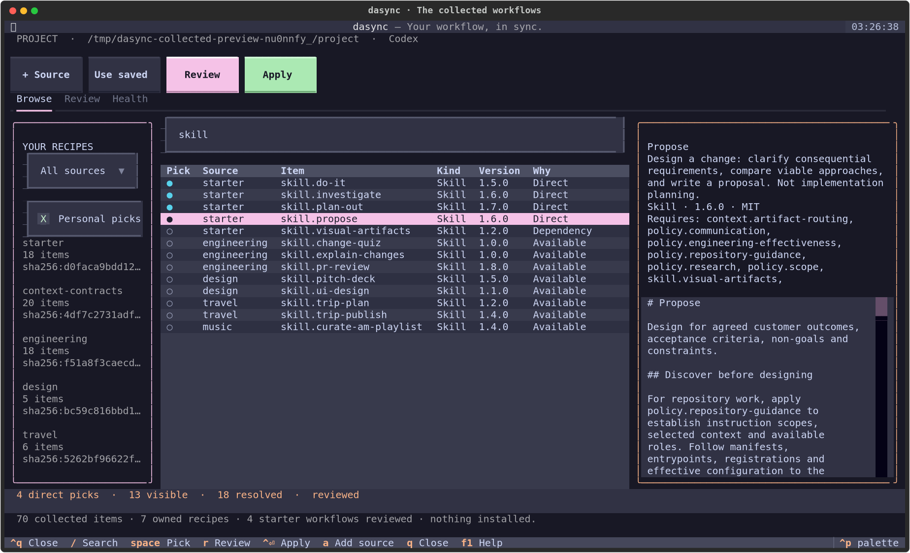

# Collected workflows as recipes

All **70 collected items** now have exactly one owner in seven local recipe sources. The original `packages/`, `profiles/` and `template-system/` remain available to existing catalog installations. During this transition they are the editable authoring sources; these recipe files are a reproducible projection, not a second independently maintained copy. No existing environment is migrated or overwritten automatically.

| Recipe | Items | Contents |
| --- | ---: | --- |
| [starter](starter/recipe.yaml) | 18 | Propose, Plan Out, Do It, Investigate and their current dependency closure, including Visual Artifacts |
| [engineering](engineering/recipe.yaml) | 18 | PR review, explain changes, change quiz, five engineering reviewers, additional policies and public references |
| [design](design/recipe.yaml) | 5 | UI design, pitch decks, design guidance and assets |
| [travel](travel/recipe.yaml) | 6 | Travel Planner/Researcher, itinerary planning and travel publishing |
| [music](music/recipe.yaml) | 2 | Playlist curation and its CSV template |
| [context-contracts](context-contracts/recipe.yaml) | 20 | Private binding contracts, preserved with qualified consumers and stable contract IDs; activation stays blocked |
| [hooks](hooks/recipe.yaml) | 1 | Credential-path guard; selection needs a separate exact-digest execution approval in the target scope |

The plan records a four-workflow closure of 17 items; the current dependency audit resolves to 18. This projection preserves the actual declared closure. Selecting the whole starter selects its current 18 items as direct roots. Selecting its four named workflows keeps supporting items as dependencies. Neither choice selects future additions automatically, and no profile or hidden preset is introduced.

Optional recipes declare imports by UUID. For example, engineering's `starter/policy.communication` refers to the starter's declared identity, regardless of the operator's registration alias. Imports do not fetch, choose a pin, register a source or grant trust. Prepare and explicitly register/bind the required local recipes before selecting a workflow that uses them.

## Try the collection

Use an existing disposable project and home for a trial. From a checkout of this PR, run `dasync tui --scope project --path /absolute/trial-project` with DASYNC_HOME pointing to the trial home. In **+ Source**, prepare `/absolute/checkout/recipes/starter`, inspect it, give it an alias and explicitly trust the source before staging. Select the four workflows or individual supporting items, review every effect, then Apply. The starter is optional; browsing and staging do not install anything. Native policies appear in the reviewed AGENTS.md output, which remains protected if it already exists.

For optional content, add its recipe and any declared imported source. The full collection can be browsed in the workspace after explicitly staging/registering all seven sources; private context names/bodies remain suppressed. X opens a separate Hook approval dialog showing its exact digest, events and declared permissions. Ordinary Apply confirmation and source trust never supply this approval.

Machine operators can prepare the sources with `dasync recipe prepare --source /absolute/checkout/recipes/starter --json --no-input` and repeat for the desired optional recipes. Save a `recipe.configure` request containing those returned candidate tokens and aliases. To select the four starter workflows, add:

```json
{
  "enable": [
    "starter/skill.propose",
    "starter/skill.plan-out",
    "starter/skill.do-it",
    "starter/skill.investigate"
  ]
}
```

This fragment belongs in the configure request, not a complete request by itself; registrations, operation and explicit trust still need the normal [plan/apply flow](../docs/recipe-protocol.md). `select_sources: ["starter"]` is the alternative that selects all current starter items. Use an accepted source binding instead of a registration when that exact pin is already registered.

For Hooks, a plan without approval returns `EXECUTABLE_TRUST_REQUIRED` with the qualified item and digest. After reviewing the pinned source files, add `approve_executables: [{source_id: UUID, item_id: "hook.credential-path-guard", digest: "EXACT_DIGEST"}]` to the reviewed configure request. Approval is stored in private machine state for that target scope, never in project intent/lock or inherited from another scope. Changed Hook bytes or execution metadata require new approval. The Python process runs in the provider's execution environment; declared permissions do not create an OS sandbox.

## What is preserved and what changes



Item IDs, versions, licenses, declared assets, optional capability preferences, role instructions and private binding contracts are retained. Skill-native frontmatter becomes canonical metadata; default prompts use the actual qualified native name. Active legacy dependency links become `dasync:dependency/IMPORT/ITEM/FILE` destinations, while local files and literal examples remain unchanged. Each selected item carries the root MIT license; UI design retains its complete upstream SwiftUI notice. [collection-audit.json](collection-audit.json) records original and canonical hashes for every declared file and the original manifest path.

The new recipe adapter supports Codex Skills, native agents, unconditional policies, Markdown/HTML templates, public contexts and separately approved Python Hooks. Existing catalog adapters for Claude/Copilot/Cursor remain usable. Standalone Codex agents inherit the parent session's permissions: current [Codex documentation](https://developers.openai.com/codex/subagents) says agent-file sandbox overrides are ignored. The collected role definitions therefore declare inherited permissions. An authored essential read-only requirement is refused by the recipe adapter, not represented as an enforced sandbox. Native [hook formats](https://developers.openai.com/codex/hooks) are structurally checked; a synthetic guard invocation does not prove a provider session fired the hook.

Private contracts contain interface guidance, not actual bound facts. This conversion performs no private lookup, grant transfer or body materialization. Use the existing catalog context flow for authorized private context until the recipe binding/read protocol is implemented. Existing installed scopes need their own reviewed migration; this content transition does not adopt their files or grants.

## Regenerate and verify

```sh
uv run python scripts/build_templates.py --check
uv run python scripts/build_recipes.py
uv run python scripts/build_recipes.py --check
uv run pytest tests/test_collection_recipes.py tests/test_collection_transactions.py tests/test_recipe_roles.py -q
```

Edit `packages/` and the canonical `template-system/` sources, then regenerate both projections. CI compares the complete recipe projection, including its provenance audit, against current source bytes. Unexpected generated files are reported rather than silently deleted. Later extraction into independently maintained repositories needs an explicit ownership/publication decision; these sources are ready for that transition without changing item identities or treating copied UUIDs as trust.
